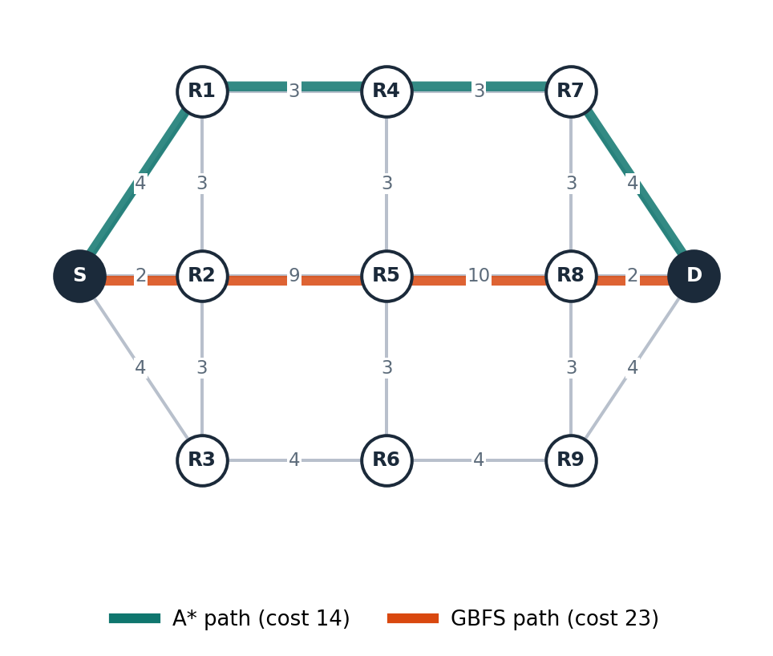

# NetPilot: Multi-Agent Network Routing with A*
### A* vs. Greedy Best-First Search for packet routing
*23CSE401 — Fundamentals of Artificial Intelligence — Case Study Report*

---

## 1. Problem Domain and Statement

A computer network is modelled as a graph of routers connected by links, each with a delay. Several **packet agents** must each find a fast route from a source router to a destination router. Agents interact indirectly: a link's delay rises with the number of packets currently using it (congestion), so one agent's route choice changes the cost landscape for every other agent. Links can also fail while a packet is in transit, forcing an agent to replan from its current router.

## 2. PEAS

- **Performance measure:** total delay of the delivered path; number of routers expanded during search; successful delivery despite failures.
- **Environment:** the router graph — nodes (routers), weighted edges (links with delay), and a congestion level per link.
- **Actuators:** choose the next router to forward the packet to (equivalently, commit to a computed path).
- **Sensors:** link delays and congestion levels of reachable links; whether a link is up or has failed.

## 3. Environment Properties

- **Partially observable:** an agent knows the delays of links in the graph it is given, but not the real-time load other agents are about to add.
- **Deterministic:** given the current graph state, a routing decision has a fixed outcome — link failures are explicit discrete events, not noise.
- **Sequential:** each hop affects the cost of future hops and the state other agents see.
- **Dynamic:** the network changes while an agent is planning/acting — other agents add congestion and links can fail mid-route.
- **Discrete:** routers, links and hop counts are all discrete.
- **Multi-agent:** multiple packet agents act in the same environment. They are not adversarial — congestion is a side effect, not a goal — so this is best described as **cooperative-by-indifference** (agents don't coordinate, but don't compete either).

## 4. Agent Type

Each packet is a **utility-based agent**: it does not just satisfy a goal (reach D), it picks the path that minimises a cost function (total delay), using a heuristic to estimate remaining cost. Because the environment is dynamic, the agent also behaves as a **replanning (reactive) agent** — on a link failure it re-invokes search from its current router rather than failing outright.

## 5. Searching Technique

We use **A\*** as the primary technique, compared against **Greedy Best-First Search (GBFS)**. Both are best-first searches over the state space (state = current router); they differ only in the priority function used to order the frontier:

> **A\*:**  f(n) = g(n) + h(n)
> **GBFS:**  f(n) = h(n)

where g(n) is the real delay accumulated so far and h(n) is the straight-line distance from router n to the destination (an *admissible* heuristic here, since no link is cheaper than the straight-line distance between its endpoints — this keeps A* optimal). The frontier is a min-heap; a node is expanded once, and the goal test happens at expansion, not at generation.

## 6. Working and Edge Cases

The figure below shows the sample network (11 routers) with the paths both algorithms returned for a single packet from S to D.

| Case | Algorithm | Path | Cost | Nodes expanded |
|---|---|---|---|---|
| Working 1: normal network | A* | S–R1–R4–R7–D | 14 | 8 |
| | GBFS | S–R2–R5–R8–D | 23 | 5 |
| Edge 1: link R4–R7 fails mid-route | A* (replan from R4) | R4–R5–R6–R9–D | 14 | 6 |
| Edge 2: all links into D removed | A* | — | ∞ (no route) | 10 |

**Why these happen.** In Working 1, GBFS greedily commits to R2 (closest to D by straight-line distance) and then R5, R8 — both legs happen to have high real delay (9 and 10), which h cannot see. A* avoids this because it also accounts for g(n), the real cost paid so far. In Edge 1, the agent does not fail when R4–R7 disappears — it re-runs A* from its current router (R4) with the failed link removed from the graph, and still reaches D at the same total cost via a different route, demonstrating recovery. In Edge 2, with D fully cut off, A* correctly exhausts every reachable router (10 of 10) and reports no route instead of looping — the closed-set check guarantees termination.

## 7. Complexity

For both algorithms, time and space complexity are O(b^m) in the worst case, where b is the branching factor (here b ≈ 2–3, since each router has 2–4 links) and m is the maximum path depth searched (here m ≤ 10, the router count). A* keeps every generated node in memory (open + closed sets), so its space complexity matches its time complexity. In practice A* expands close to the number of nodes actually on or near the optimal path when h is informative, while GBFS can expand far fewer nodes than A* (5 vs. 8 in Working 1) because it ignores g(n) entirely — but this is exactly why it can also expand far *more* nodes than A* on a graph where h is misleading, since a poor greedy choice forces long backtracking later. Neither algorithm revisits a closed router, so termination on a finite graph is guaranteed.

## 8. Comparison

**A\* vs. GBFS:** A* is optimal when h is admissible, since it never commits to a path until g+h proves no cheaper alternative remains; GBFS is not optimal — it can be misled by h into a locally-attractive but globally expensive route, exactly as seen in Working 1 (cost 23 vs. 14, a 64% worse route). GBFS's only advantage is that it can expand fewer nodes when h happens to point toward the true path, trading solution quality for speed.

**Why not plain Dijkstra / BFS:** Dijkstra's algorithm (A* with h=0 everywhere) is also optimal but expands more nodes than A*, since it has no sense of direction toward the goal — it explores uniformly outward. BFS only works on unweighted graphs and cannot account for link delay at all, so it is unsuitable here.

**Limitations:** if h were inadmissible (overestimates true distance for some router), A* would lose its optimality guarantee. Neither algorithm currently coordinates agents directly — congestion is felt only after another agent commits to a path, not predicted in advance — so a next step would be cooperative or priority-based multi-agent planning.

## 9. Conclusion

A* consistently returns the lower-delay route in this network because it balances real cost-so-far against estimated cost-to-go, while GBFS's purely heuristic-driven choice leads it into slow links it cannot see coming. A*'s replanning on link failure and clean termination on an unreachable destination show it handles the dynamic, multi-agent aspects of the problem correctly, at the cost of expanding more nodes than a greedy approach.
